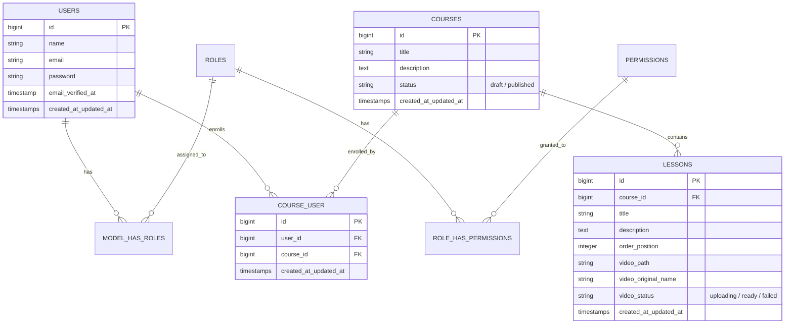
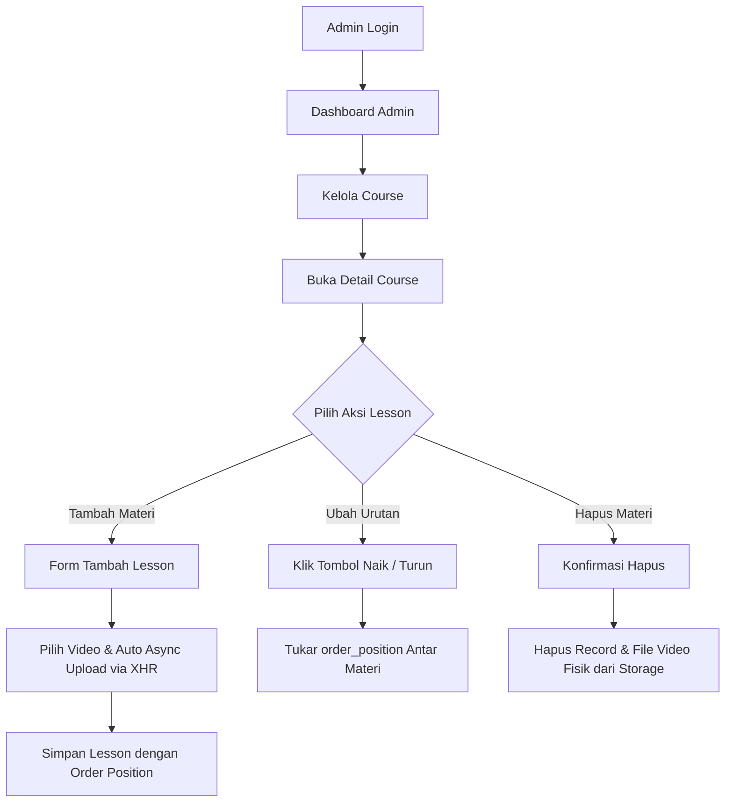

# Simple E-Learning Platform

> **Technical Assessment — Web Developer (Track A)**  
> Implementasi platform pembelajaran daring sederhana berbasis **Laravel, Blade, dan Tailwind CSS** dengan pemisahan area otorisasi **Admin** dan **Student**, manajemen materi bertingkat (*Course & Lesson*), pengurutan materi, serta pengunggahan dan pemutaran video secara terotorisasi.

---

## 1. Akun Demo

Aplikasi sudah dilengkapi dengan seeder akun demo dan data pembelajaran realistis:

| Role | Email | Password | Hak Akses |
|---|---|---|---|
| **Admin** | `admin@example.com` | `password` | Kelola Course, Lesson, Video Upload, User, dan Role Permissions |
| **Guru** | `guru@example.com` | `password` | Kelola Course dan Lesson Pembelajaran |
| **Student** | `student@example.com` | `password` | Akses Katalog Kursus, Ruang Belajar, dan Pemutaran Video |

---

## 2. Fitur Utama (Kepatuhan Brief Track A)

### A1. Fitur Wajib
- [x] **Authentication & Authorization**: Otentikasi berbasis session (Laravel Breeze) dengan pembagian role menggunakan `spatie/laravel-permission`. Route admin dilindungi middleware `permission:manage-courses`, dan student otomatis dicegah masuk (`403 Forbidden`).
- [x] **Course Management**: CRUD penuh untuk kursus (judul, deskripsi lengkap, status `draft` / `published`, validasi form, dan notifikasi).
- [x] **Lesson Management**: CRUD materi pembelajaran untuk setiap kursus, dilengkapi dengan kolom nomor urut (`order_position`) dan tombol pemindah urutan **Naik (▲) / Turun (▼)** secara instan.
- [x] **Video Upload**: Admin dapat mengunggah file video untuk setiap materi. Didukung unggahan asinkronus (*AJAX/XHR*) dengan **indikator progress bar (0% – 100%)** *real-time* serta penanganan status video (`uploading` → `ready` / `failed`).
- [x] **Student Course View**: Student hanya dapat melihat kursus yang telah dipublikasikan (`published`), membuka ruang belajar interaktif dengan pemutar video HTML5, berpindah materi via playlist terurut, serta navigasi materi sebelumnya/selanjutnya.
- [x] **Pemutaran Video Terotorisasi**: Video disimpan di penyimpanan privat (`storage/app/private/videos`), bukan di folder publik. Akses video disajikan melalui route streaming terproteksi (`/lessons/{lesson}/video`) yang memverifikasi izin hak akses dan status kursus.

### A2. Batasan Teknis yang Dipenuhi
- Bersih dari dependensi infrastruktur berat: tidak mewajibkan Redis, Queue Worker, FFmpeg, transcoding, HLS, maupun Cloud Object Storage.
- File video contoh aman berukuran ringan (`sample.mp4`) telah disediakan di storage privat untuk kebutuhan evaluasi langsung.

---

## 3. Pilihan Teknologi & Alasan Pemilihan (A3)

| Komponen | Pilihan Teknologi | Alasan Pemilihan |
|---|---|---|
| **Framework** | Laravel 12 / 13 | Standar wajib Track A; menyediakan ekosistem otentikasi aman, abstraksi storage privat, ORM Eloquent ekspresif, dan test runner terintegrasi. |
| **Bahasa** | PHP 8.2+ | Bahasa inti Laravel dengan fitur modern (*constructor property promotion*, *strict typing*, dan sintaks ekspresif). |
| **Database** | SQLite & MySQL Ready | SQLite digunakan secara default untuk kemudahan portabilitas evaluasi demo instan tanpa konfigurasi server DBMS eksternal; skema migration 100% kompatibel dan siap dialihkan ke MySQL via `.env`. |
| **Templating** | Blade | Templating engine bawaan Laravel yang cepat, aman dari XSS (*escaped output*), dan mudah dipelihara tanpa *overhead* framework SPA. |
| **Styling** | Tailwind CSS v4 | Menyediakan sistem utilitas desain responsif (*Evaly Design System*) yang konsisten, bersih, dan modern di seluruh perangkat. |
| **Upload Engine** | Vanilla JS + XMLHttpRequest | Mengimplementasikan pengunggahan asinkronus dengan pelacakan progres unggahan (`upload.onprogress`) secara andal tanpa library tambahan pihak ketiga. |
| **Otorisasi Role** | Spatie Laravel-Permission | Standar industri untuk kontrol akses berbasis peran (*RBAC*) yang fleksibel, teruji keamanannya, dan mudah diaudit. |

---

## 4. Panduan Menjalankan Aplikasi

### Persyaratan Sistem
- PHP >= 8.2 dengan ekstensi `pdo`, `pdo_sqlite` (atau `pdo_mysql`), `mbstring`, `fileinfo`, `openssl`, `tokenizer`, `xml`, `ctype`, `json`.
- [Composer](https://getcomposer.org/)
- [Node.js & NPM](https://nodejs.org/)

### Langkah Instalasi
1. **Clone / Buka Direktori Projek**:
   ```bash
   cd e-larning
   ```

2. **Pasang Dependensi PHP & JavaScript**:
   ```bash
   composer install
   npm install
   ```

3. **Konfigurasi Environment**:
   Salin file konfigurasi environment dan buat encryption key aplikasi:
   ```bash
   cp .env.example .env
   php artisan key:generate
   ```

4. **Jalankan Migrasi Database & Seeder**:
   Perintah ini akan membuat skema tabel, role permissions, akun demo, data dummy kursus, serta otomatis menginisialisasi penyimpanan video lokal (`storage/app/private/videos/sample.mp4`):
   ```bash
   php artisan migrate:fresh --seed
   ```
   *(Catatan: Direktori video dan sample video juga dapat diinisialisasi secara mandiri kapan saja dengan perintah `php artisan app:setup-video`).*

5. **Kompilasi Aset Frontend**:
   ```bash
   npm run build
   # atau untuk mode development: npm run dev
   ```

6. **Jalankan Server Lokal**:
   ```bash
   php artisan serve
   ```
   Aplikasi dapat diakses melalui browser di: **`http://127.0.0.1:8000`**

7. **Menjalankan Pengujian Otomatis (Automated Tests)**:
   ```bash
   php artisan test
   ```
   *(64 skenario pengujian fungsional, otorisasi, video command, dan enrollment terkonfirmasi lulus / 100% pass).*

---

## 5. Desain Sistem & Arsitektur

### 5.1 Diagram Model Data (Entity-Relationship Diagram / ERD)



### 5.2 Flowchart Alur Pengelolaan Materi (Admin)



### 5.3 Flowchart Alur Pemutaran Video (Student)

```mermaid
flowchart TD
    A[Student Login] --> B[Katalog Kursus Saya]
    B --> C[Pilih Kursus Published]
    C --> D[Buka Ruang Belajar /courses/{id}]
    D --> E[Sistem Mengambil Lesson Terurut Berdasarkan order_position]
    E --> F[Pilih Lesson Tertentu di Playlist]
    F --> G[Browser Meminta Stream /lessons/{id}/video]
    G --> H{Cek Hak Akses & Status}
    H -->|User Belum Login| I[Dialihkan ke Halaman Login]
    H -->|Course Masih Draft & Bukan Admin| J[Tolak Akses - 403 Forbidden]
    H -->|File Tidak Ada di Storage| K[Tampilkan 404 Not Found]
    H -->|Valid & Terotorisasi| L[Stream Binary Video dari Storage Privat]
    L --> M[Video Berputar pada Player HTML5]
```

---

## 6. Catatan Asumsi & Keterbatasan Teknis

1. **Satu Video per Lesson**: Setiap materi pembelajaran diasumsikan memiliki 1 file video panduan utama.
2. **Penyimpanan Lokal Privat**: Sesuai batasan poin A2 brief, video disimpan pada disk lokal privat server (`storage/app/private/videos`) yang tidak terekspos langsung ke URL publik, sehingga setiap permintaan video wajib melewati *gatekeeper* otorisasi Laravel.
3. **Kompatibilitas Format Video**: Format MP4 (*H.264 / AAC*) direkomendasikan karena kompatibel secara *native* pada semua peramban web modern tanpa memerlukan proses *transcoding* di sisi server.
4. **Pemisahan Status Draft & Published**: Kursus yang berstatus `draft` hanya dapat diakses dan dikelola oleh Admin/Guru; sistem menjamin kursus draft tidak akan muncul pada katalog maupun dapat diputar materinya oleh Student.

---

## 7. Lisensi & Hak Cipta
Projek ini dikembangkan sebagai bagian dari pemenuhan *Technical Assessment Web Developer (Track A)*.
